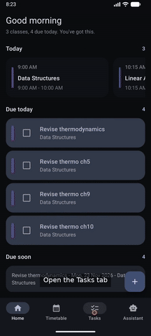

# android-reel

Client-ready Android demo videos driven by real taps, with an amber finger
that glides between taps and ripples on contact — the mobile sibling of
`demo-reel` (web).



*`examples/campusplanner-proof.mp4` (28s, 720x1600, 1.4MB): create a Campus
Planner assignment, set High priority, tick it done, filter to Done.*

## Install

```bash
npx skills add arjunsharmahehe/skills --skill android-reel
cp -r <skill>/assets/android-template <project>/.demo-android/
```

See [SKILL.md](SKILL.md) for the record loop.
