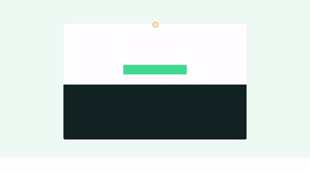

# demo-reel

Record client-ready demo videos of web features with an agent driving a real browser using human-like motion. You describe the flow; the agent clicks, types, and scrolls like a person, narrates with burned-in captions, and hands back a shareable `proof.mp4` — no manual screen recording, no retakes from scratch.



*Above: a full buy-a-backpack flow on SauceDemo, recorded by an agent with zero human input. [Watch the mp4](./examples/saucedemo-proof.mp4) (34s, 0.23MB, 720p). Disable VLC's subtitle track before previewing (it auto-loads the sidecar `.srt`).*

## Install

```bash
npx skills add arjunsharmahehe/skills --skill demo-reel
```

Check it resolves first: `npx skills add arjunsharmahehe/skills --skill demo-reel --list`

Requires: Node 18+, `ffmpeg`, and a launchable Playwright Chromium (`node scripts/check-env.mjs` verifies all three after install).

## Use

In a project, the skill scaffolds a `.demo/` workspace and works in a loop:

```bash
cd <project>/.demo && npm install && node scripts/check-env.mjs
node scripts/new-flow.mjs <name>   # scaffold flows/<name>.json, then edit it
node scripts/validate.mjs --flow <name>   # static gate — must pass before recording
node scripts/record.mjs --flow <name>     # → out/<name>/proof.mp4 + proof.md + proof.srt
```

Retake a bad chapter without re-recording everything:

```bash
node scripts/record.mjs --flow <name> --from <step-id>   # fragment → retakes/<step>/
node scripts/stitch.mjs --flow <name>                    # assemble the final proof.mp4
```

If a run fails, you get `error-report.md` + a failure screenshot + partial footage, with the exact resume command. Failures always end in artifacts, never silence.

## How it works

- **Flows are declarative JSON** (`flows/*.json`): steps with narration captions and actions (`goto`, `click`, `pick`, `type`, `fill`, `select`, `scrollTo`, `assert`, `extract`, …). See `references/flow-authoring.md` for the catalog.
- **Motion is human**: eased scrolling, bezier-curve mouse, variable-delay typing — never raw `mouse.move` / `scrollIntoView` / `fill`.
- **Navigation is UI-first**: click through the app like a viewer would; deep `goto`s are allowed only as marked exceptions.
- **State is resumable**: session + per-step snapshots mean `--from` replays from exactly the state the full run saw — auth runs once.
- **Captions narrate the feature** for non-technical viewers; receipts (`proof.md`) stay in the appendix. See `references/narration.md`.

## Layout

```
demo-reel/
  SKILL.md                  # the skill (this is what the agent reads first)
  references/               # flow-authoring, narration, troubleshooting
  assets/demo-template/     # scaffold copied into the user's .demo/
    scripts/                # record, validate, new-flow, check-env, stitch + lib/
    flows/                  # worked examples (blog search, purchase order, backpack)
    schemas/                # JSON Schema for editor support
  examples/                 # proof videos (not shipped to users)
```

## Safety note

`scripts/` runs a local headless Chromium (via Playwright) and `ffmpeg` — everything stays on your machine, against URLs you put in your own flows. Review `flows/*.json` before recording, the same way you'd review any automation touching your apps.
